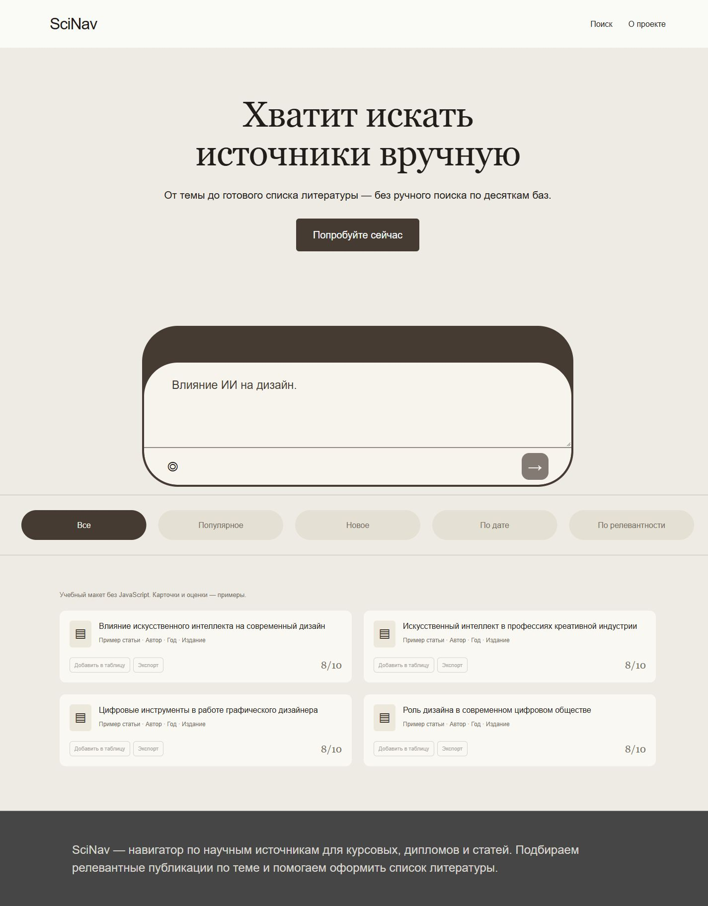
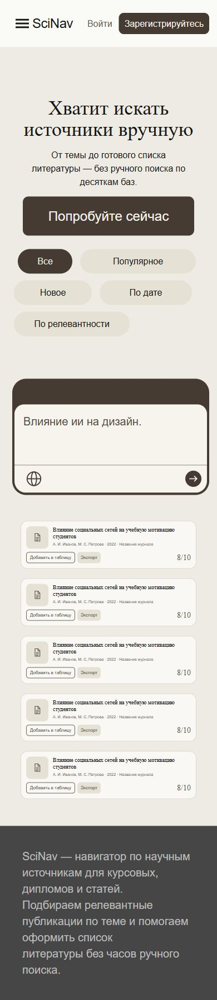

# SciNav

Статическая вёрстка по финальной странице 03_Finaly в Figma. Только HTML и CSS, без JavaScript и зависимостей.

## Макет

[Figma — 03_Finaly](https://www.figma.com/design/uDwovncQ7C44KhJiqFlG1q/Untitled?node-id=154-2)

## Структура

- index.html — структура страницы и карточки-примеры из макета.
- css/style.css — все стили и адаптивная вёрстка.
- screenshots/ — полноразмерные скриншоты desktop и mobile.
- submission-comment.md — краткий комментарий для сдачи.

## Запуск

Откройте папку проекта в VS Code, затем index.html через Open with Live Server. Можно также открыть HTML обычным браузером. Распакуйте ZIP полностью, чтобы подключился CSS.

## Что реализовано

Шапка с меню и регистрацией, главный экран, окно ввода, фильтры, сетка карточек и подвал. На desktop шесть карточек, на mobile пять, как в макете. Общие цвета, шрифты, отступы и радиусы находятся в :root. Шапка и карточки используют Flexbox, сетка — Grid. Медиазапросы при 1100 и 600 px, дополнительная настройка для ширины менее 390 px. Есть стили hover, focus-visible, active и disabled. На телефоне одна колонка карточек, фильтры находятся выше поиска.

## Ограничения

Это статическая вёрстка. Поиск, фильтры, вход, регистрация, добавление в таблицу и экспорт не выполняют действий и обозначены aria-disabled. JavaScript не подключён. Оценки 8/10 показаны как элементы макета и не рассчитываются. Работают ссылки на разделы и ввод текста. Нет API, localStorage, авторизации и всплывающих окон.

## Скриншоты

